# Guía de pruebas (QA) del conector con Activity Report

Esta guía es para quien va a probar la aplicación sin haberla construido. Explica
qué hace, cómo montarla en tu equipo **sin conectarla a BBVA**, cómo se usa cada
pantalla y qué casos de prueba hay que pasar.

Todas las capturas están hechas con datos inventados (personas `XE1000xx`,
proyectos `SDATOOL-xxxxx` de los ficheros de ejemplo).

## Índice

1. [Qué es la aplicación](#1-qué-es-la-aplicación)
2. [Montar el entorno de pruebas](#2-montar-el-entorno-de-pruebas)
3. [Conceptos que hay que entender antes de probar](#3-conceptos-que-hay-que-entender-antes-de-probar)
4. [Recorrido por las pantallas](#4-recorrido-por-las-pantallas)
5. [Simular a BBVA: envíos, feedback y altas](#5-simular-a-bbva-envíos-feedback-y-altas)
6. [Casos de prueba](#6-casos-de-prueba)
7. [Cómo informar de un fallo](#7-cómo-informar-de-un-fallo)
8. [Reiniciar el entorno](#8-reiniciar-el-entorno)

---

## 1. Qué es la aplicación

Arktic es proveedor de BBVA, y BBVA exige que cada consultor externo registre
sus horas en su herramienta **Activity Report** (AR). En lugar de que cada
persona entre en AR, un gestor de Arktic lleva las imputaciones de todo el
equipo en este panel y el conector se encarga del resto:

- **Imputar**: cada persona tiene una *plantilla* con lo que hace un día normal
  (por ejemplo, 8 h en un proyecto). Solo hay que registrar las excepciones:
  vacaciones, festivos locales, días repartidos entre proyectos.
- **Enviar**: tres veces al día (13:00, 18:00 y 21:00) el conector genera un
  fichero CSV con los días del periodo abierto y lo sube a la API de BBVA.
- **Descargar de BBVA**: cada madrugada descarga los *catálogos* (actividades,
  proyectos, issues de Jira…) y el *feedback* del envío del día anterior, que
  dice qué líneas ha rechazado BBVA y por qué.
- **Avisar**: detecta *huecos* (días laborables sin nada que enviar) y avisa
  antes de que cierre el plazo.
- **Dar de alta** en AR a las personas nuevas.

Hay dos tipos de usuario del panel:

| Rol | Qué ve |
|---|---|
| **Gestor** (MANAGER) | Todo: situación, personas, envíos, altas, rechazos, importación, catálogos, festivos y usuarios |
| **Consultor** (CONSULTANT) | Solo "Mi mes": sus propios días |

## 2. Montar el entorno de pruebas

> **Importante:** las pruebas se hacen siempre en modo `filesystem`, que **no
> habla con BBVA**. Lee los catálogos de ficheros de ejemplo y deja los envíos
> en una carpeta. No uses nunca la credencial de BBVA ni el `.env` del
> entorno real.

### Requisitos

- Windows con **Docker Desktop** arrancado.
- **Git**.

### Pasos

1. Clona el repositorio y entra en la carpeta:

   ```powershell
   git clone https://github.com/jorgersaiz/ar-connector.git
   ```

   ```powershell
   cd ar-connector
   ```

2. Crea el `.env` a partir del ejemplo:

   ```powershell
   Copy-Item .env.example .env
   ```

3. Abre el `.env` y deja estos valores (el resto, como vienen):

   ```
   AR_CLIENT=filesystem
   AR_LOCAL_DIR=/app/samples/catalogues
   AR_UPLOADS_ENABLED=true
   ADMIN_PASSWORD=admin1234
   ```

   `AR_UPLOADS_ENABLED=true` permite probar los envíos: en modo `filesystem` no
   salen del equipo, se escriben en `samples/catalogues/outbox/`. Si el puerto
   5432 lo usa otro programa, pon también `DB_HOST_PORT=5433`.

4. Arranca la aplicación (la primera vez tarda unos minutos):

   ```powershell
   docker compose up --build -d
   ```

5. Abre **http://localhost:4200** y entra con `admin@arktic.local` /
   `admin1234`.

6. Ve a **Catálogos** y pulsa **Sincronizar ahora**. Los 8 catálogos deben
   quedar con fecha de hoy y filas (13 actividades, 5 proyectos SDA…).

Arriba, junto al título de "Situación", tiene que aparecer la etiqueta **"Sin
conexión con BBVA (ficheros de ejemplo)"**. Si pone DEV, AU o PRO, para: el
entorno está conectado a BBVA.

### Datos de ejemplo disponibles

Los catálogos de ejemplo (`samples/catalogues/`) traen, entre otros:

| Código | Qué es | Exige |
|---|---|---|
| `01.01.01` | Proyectos SDA / Desarrollo / Construcción | Proyecto SDA |
| `01.01.02` | Proyectos SDA / Desarrollo / Desarrollo de feature | SDA + issue de Jira |
| `01.02.01` | Proyectos SDA / Evolutivo / Feature de evolutivo | SDA evolutivo + issue |
| `02.01` | Proyectos no SDA / Soporte | Proyecto no SDA |
| `03.01` | Actividades generales / Formación | Nada |
| `03.02` | Actividades generales / Reuniones | Nada |
| `03.03` | Actividad antigua | Dada de baja el 10/03/2026 |
| `01.01`, `01`, `02`, `03` | Nodos intermedios | No se pueden imputar |

| Proyecto SDA | Estado |
|---|---|
| `SDATOOL-37040` Plataforma de pagos | Activo |
| `SDATOOL-10001` Bolsa de evolutivos Canales | Activo, evolutivo |
| `SDATOOL-20500` Migración core bancario | Cerrado (Ended) |
| `SDATOOL-30777` Onboarding digital | En pausa (On hold) |
| `SDATOOL-40123` Proyecto cerrado | Dado de baja |

Issues de Jira: `ETR-01` (de `SDATOOL-37040`), `ETR-02`, `ETR-03` (evolutivo)…
Proyectos no SDA: "Soporte interno", "Oficina de proyectos" y "Proyecto
retirado" (dado de baja).

En [`docs/qa/ficheros/`](qa/ficheros/) hay CSV listos para las pruebas de
importación. **Sus fechas son de noviembre de 2026**: cámbialas por días del
periodo abierto cuando pruebes (ver el punto 3).

## 3. Conceptos que hay que entender antes de probar

**Día completo.** BBVA guarda las imputaciones por persona y día. Cada envío
sustituye el día entero, así que el conector siempre manda el día completo con
todas sus líneas.

**Minutos.** El tiempo va en minutos: una jornada de 8 h son 480. Cada línea
tiene entre 1 y 1440 minutos, y la suma de un día no puede pasar de 1440.

**Plantilla y excepciones.** Un día laborable sin nada registrado se imputa
con la plantilla de la persona. Un día editado a mano o importado (una
*excepción*) manda sobre la plantilla. "Volver a plantilla" borra la excepción.

**Quincenas y fechas límite.** BBVA solo admite cambios en el periodo
modificable:

| Quincena | Se puede enviar hasta |
|---|---|
| Del 1 al 15 | el día **19** del mismo mes |
| Del 16 a fin de mes | el día **4** del mes siguiente |

Pasada esa fecha, los días de esa quincena quedan **cerrados** (candado) y no se
pueden editar. La pantalla "Situación" dice qué quincenas siguen abiertas y su
fecha límite. **Usa siempre días de una quincena abierta** en tus pruebas.

**Fines de semana y festivos.** Los fines de semana y los festivos nacionales
no se envían (BBVA ya los conoce). Los festivos locales sí, como *día no
imputable*.

**Hueco.** Día laborable, ya pasado, sin nada que enviar: no tiene plantilla
ni excepción. Se marca en rojo.

**Cuota.** BBVA admite 3 envíos al día (6 si el último ha fallado). Si el
fichero no ha cambiado desde el último envío correcto de hoy, el conector no
lo manda y no gasta cuota (estado `UNCHANGED`).

**Feedback y rechazos.** BBVA procesa el fichero por la noche y al día
siguiente publica un *feedback* con las líneas rechazadas y un código
(`APV_01` a `APV_09`). El conector lo descarga y marca esos días en rojo.

**Person ID.** BBVA no recibe el identificador de la persona (`XE…`), sino un
hash SHA-256 de él (el *Person ID*), visible en la ficha de cada persona.

## 4. Recorrido por las pantallas

### Login

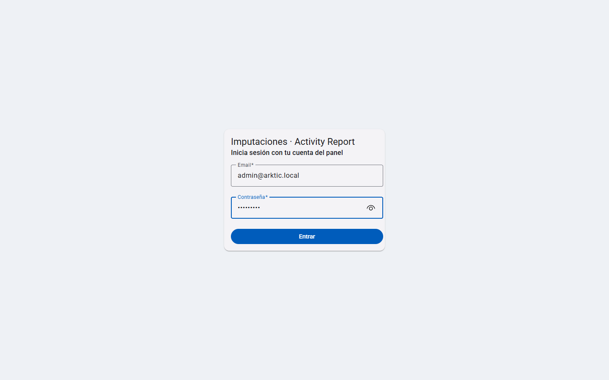

Email y contraseña. Un gestor entra en "Situación"; un consultor, en "Mi mes".
El icono de la esquina superior derecha cierra la sesión.

### Situación (página de inicio del gestor)

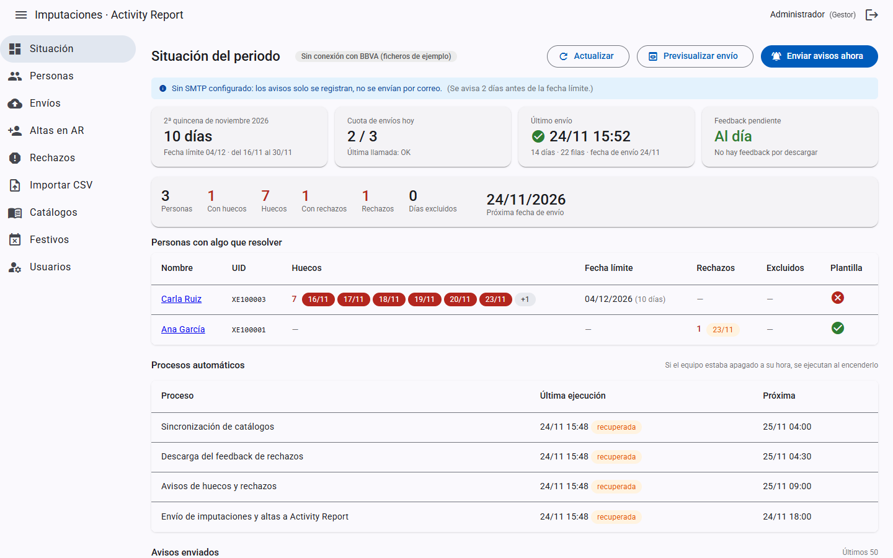

Resumen de todo lo que hay que vigilar:

- **Tarjetas superiores**: quincena abierta con los días que quedan y su fecha
  límite, cuota de envíos de hoy, último envío y feedback pendiente.
- **Contadores**: personas, personas con huecos, huecos, rechazos y días
  excluidos (días que no se han podido enviar por algún problema).
- **Personas con algo que resolver**: solo salen quienes tienen huecos,
  rechazos o días excluidos. La columna "Plantilla" indica si la persona tiene
  plantilla (sin plantilla, todos sus días laborables son huecos).
- **Procesos automáticos**: última y próxima ejecución de cada proceso. Si el
  equipo estaba apagado a la hora, el proceso se ejecuta al encender y aparece
  como "recuperada".
- **Avisos enviados**: histórico de avisos.

Botones: **Actualizar**, **Previsualizar envío** (lleva a Envíos) y **Enviar
avisos ahora**.

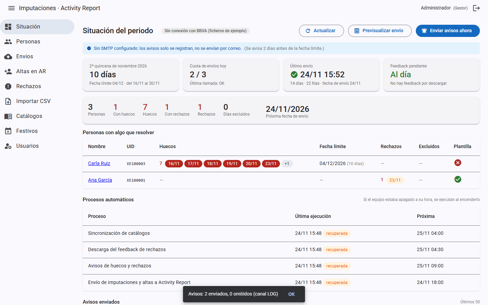

Sin servidor de correo configurado, los avisos solo se registran (canal LOG):
el mensaje inferior dice cuántos se han generado y aparecen en "Avisos
enviados". Pulsarlo dos veces el mismo día no repite los avisos ya generados.

### Personas

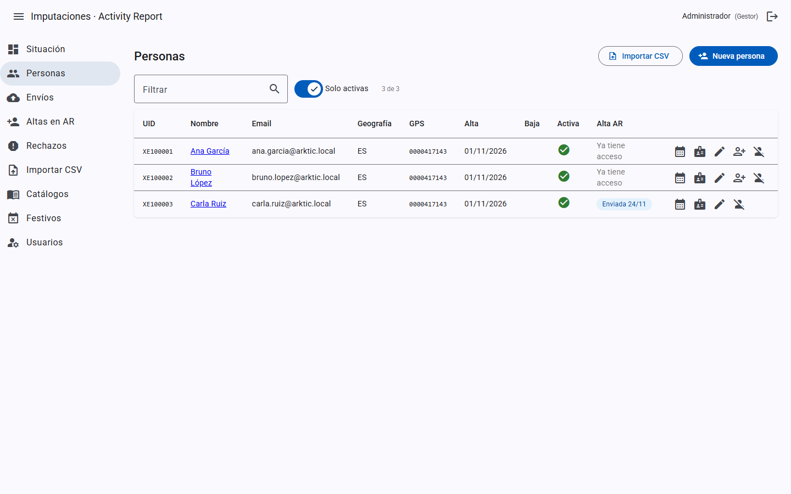

Lista con filtro y el interruptor "Solo activas". Iconos de cada fila, de
izquierda a derecha: **ver mes**, **ficha**, **editar**, **pedir alta en AR**
(o **cancelar alta**, si está pendiente) y **dar de baja**. Pasando el ratón
por cada icono se ve qué hace.

La columna "Alta AR" indica si la persona ya tiene acceso a Activity Report o
en qué punto está su alta (ver [Altas en AR](#altas-en-ar)).

**Nueva persona**:

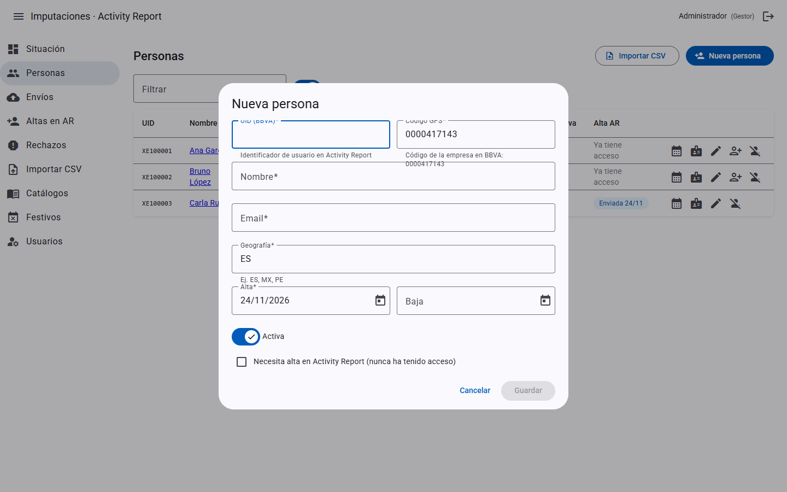

UID de BBVA, nombre, email, geografía, código GPS (viene propuesto el de
Arktic), fecha de alta y, opcionalmente, de baja. La casilla "Necesita alta en
Activity Report" la deja pendiente de alta. Un UID repetido da error.

### Ficha de una persona y plantillas

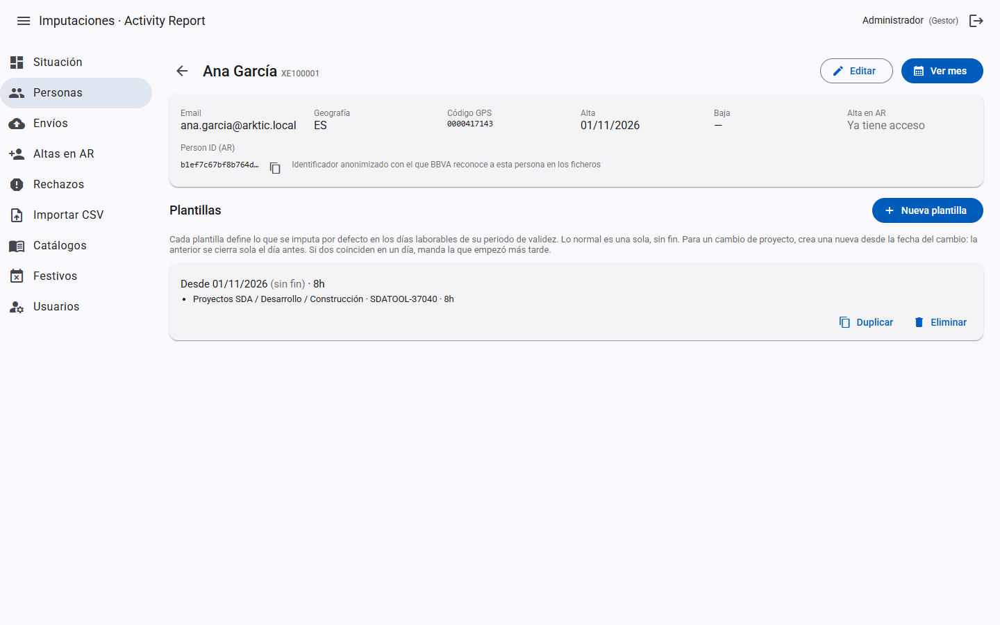

Datos de la persona, su Person ID (con botón para copiarlo) y sus
**plantillas**. Lo normal es una sola, sin fecha de fin. Para un cambio de
proyecto se crea otra desde la fecha del cambio y la anterior se cierra sola
el día antes.

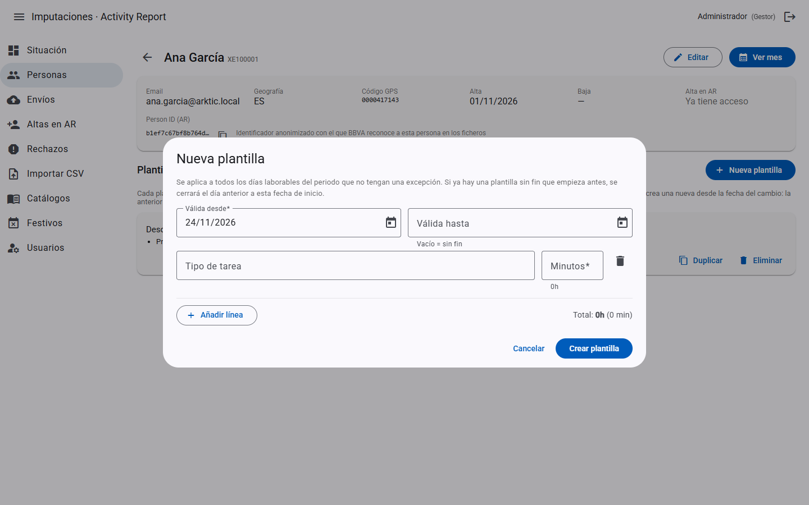

Cada línea lleva un tipo de tarea (actividad), los campos que esa actividad
exige (proyecto SDA, issue de Jira o proyecto no SDA) y los minutos. Abajo se
ve el total.

### Mes de una persona

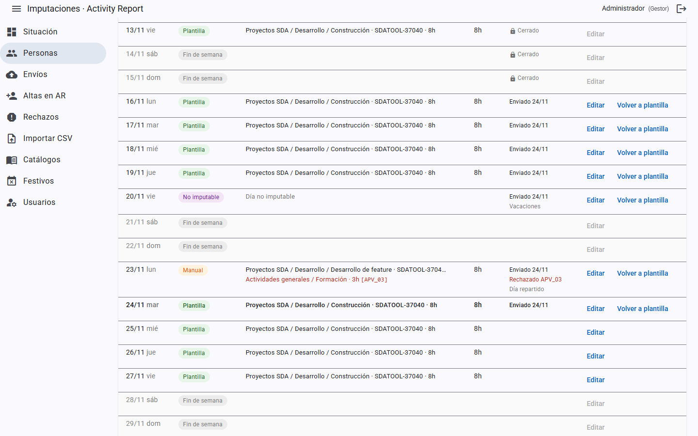

Un día por fila. La columna **Estado** dice de dónde sale lo que se envía:

| Estado | Significado |
|---|---|
| Plantilla | Se envía la plantilla |
| Manual | Excepción editada a mano |
| Importado | Excepción cargada por CSV |
| No imputable | Vacaciones, baja, etc. |
| Festivo local | Se envía como no imputable |
| Fin de semana / Festivo nacional | No se envía |
| **Hueco** (rojo) | Laborable pasado sin nada que enviar |

La columna **Envío** muestra "Cerrado" (con candado) si el plazo ha pasado,
"Enviado dd/mm" si ya se ha mandado y, en rojo, "Rechazado APV_xx" si BBVA lo
rechazó. Pasando el ratón por la fecha se ve la fecha límite de envío de ese
día. **Editar** abre el día; **Volver a plantilla** borra la excepción.

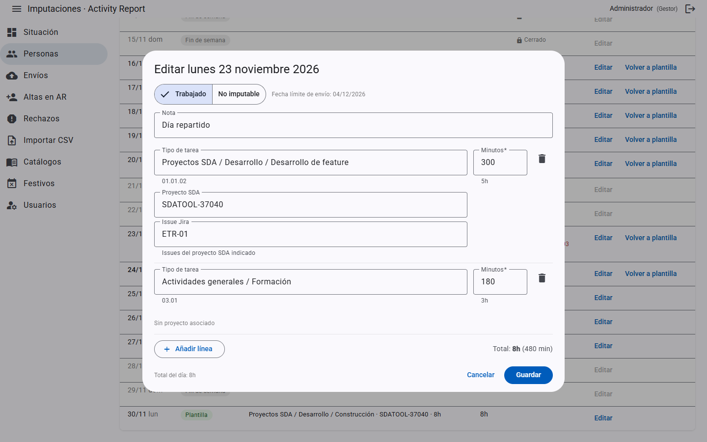

"Trabajado" o "No imputable", una nota opcional y las líneas. Al elegir el
tipo de tarea aparecen los campos que exige: proyecto SDA, issue de Jira
(solo las del proyecto indicado) o proyecto no SDA. El total del día se
recalcula al cambiar los minutos.

### Envíos

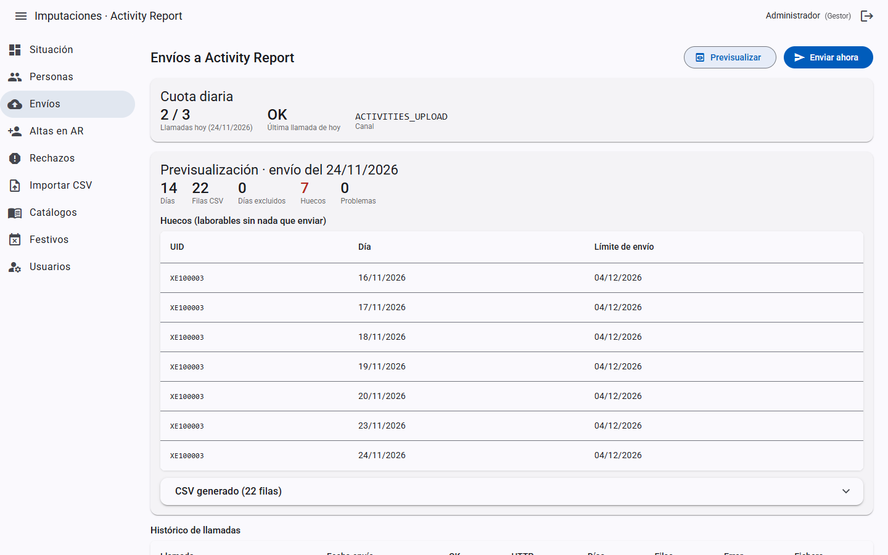

- **Previsualizar**: genera el fichero sin enviarlo. Muestra los días y filas
  que se mandarían, los días excluidos con su motivo, los huecos y el CSV
  exacto ("CSV generado").
- **Enviar ahora**: hace el envío en el momento, sin esperar a las horas
  programadas.
- **Cuota diaria** y **Histórico de llamadas**: cada envío con su resultado,
  código HTTP, días, filas y el fichero exacto que se mandó (icono de la
  derecha).

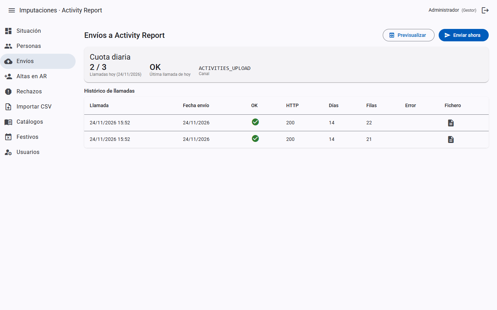

### Altas en AR

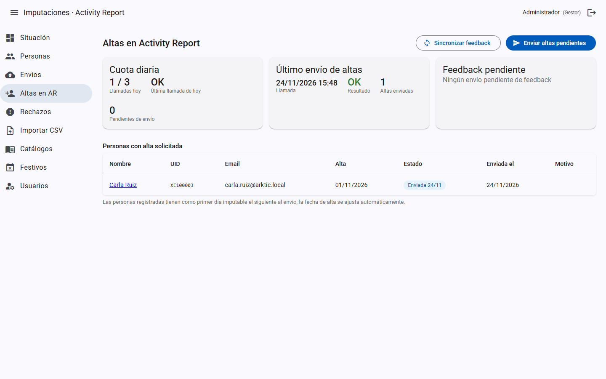

Personas con alta solicitada y su estado:

| Estado | Significado |
|---|---|
| Pendiente | Se enviará en el próximo envío |
| Enviada dd/mm | Mandada a BBVA; falta su respuesta (llega al día siguiente) |
| Registrada | BBVA la ha dado de alta; su primer día imputable es el siguiente al envío |
| Rechazada | BBVA no la acepta; el motivo (`APV_UR_xx`) sale en la tabla |

Botones: **Enviar altas pendientes** y **Sincronizar feedback**. Tienen su
propia cuota, separada de la de imputaciones.

### Rechazos

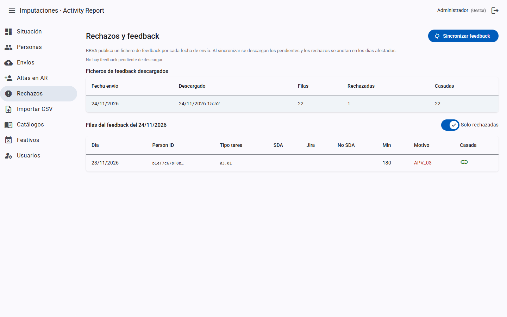

Ficheros de feedback descargados (filas, rechazadas y casadas con lo enviado).
Al pulsar uno se ven sus filas; el interruptor "Solo rechazadas" filtra las que
tienen motivo. Pasando el ratón por el código se ve qué significa. **Sincronizar
feedback** descarga los pendientes de días anteriores.

### Importar CSV

Dos pestañas: **Días (imputaciones)** y **Personas (altas)**. Cada una explica
debajo el formato del fichero y tiene **Descargar plantilla**. Acepta los CSV
de Excel en español ("CSV delimitado por punto y coma"), con tildes y fechas
`01/11/2026`.

La importación de días es **todo o nada**: si una fila falla, no se guarda
ninguna y se listan todos los errores.

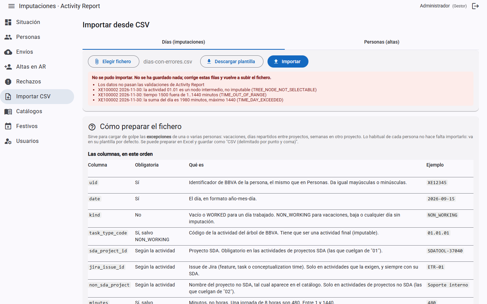

La de personas tiene un paso previo, **Comprobar**, que enseña qué va a crear
o cambiar sin guardar nada. Después, **Importar** lo guarda.

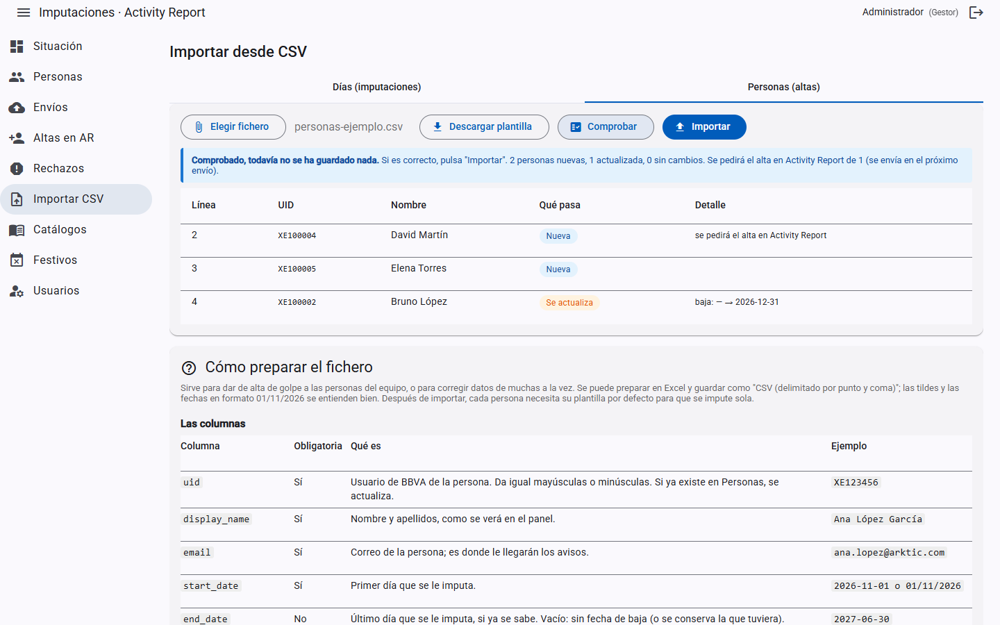

### Catálogos

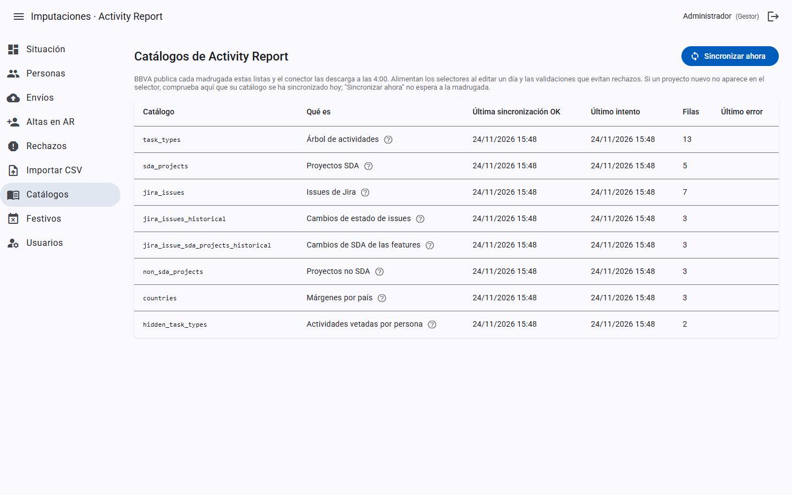

Estado de los 8 catálogos de BBVA: última sincronización correcta, último
intento, filas y último error. El icono de ayuda explica cada uno. **Sincronizar
ahora** los vuelve a descargar (lo normal es a las 4:00).

### Festivos

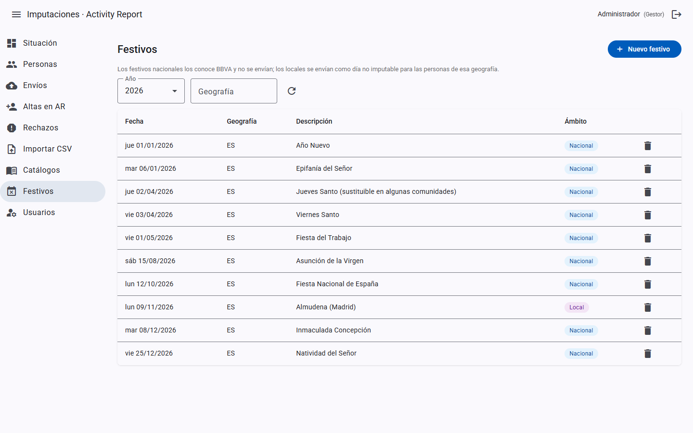

Festivos por año y geografía. Los **nacionales** no se envían; los **locales**
se envían como día no imputable a las personas de esa geografía.

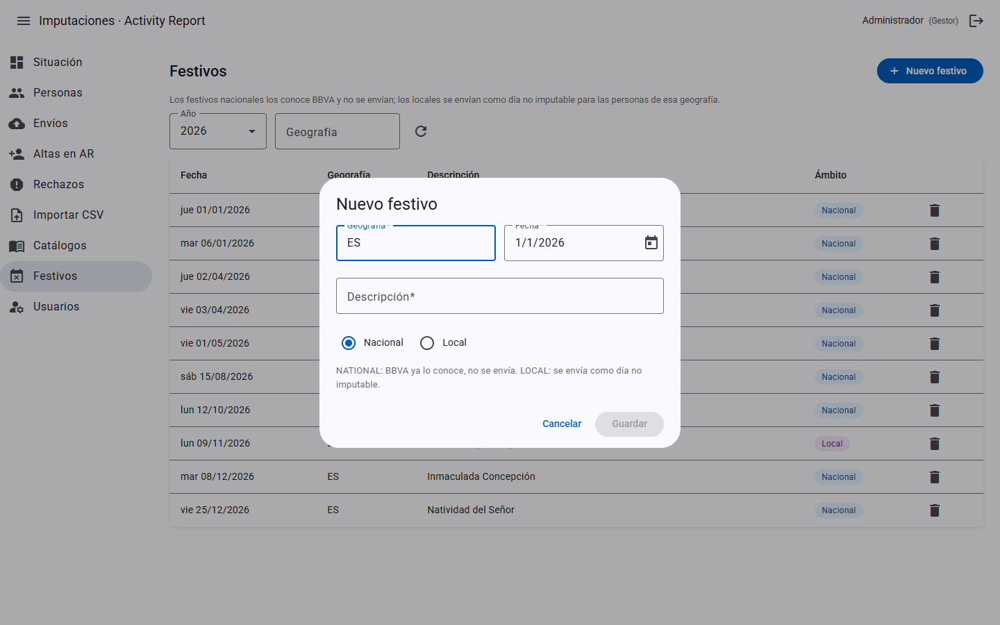

### Usuarios del panel

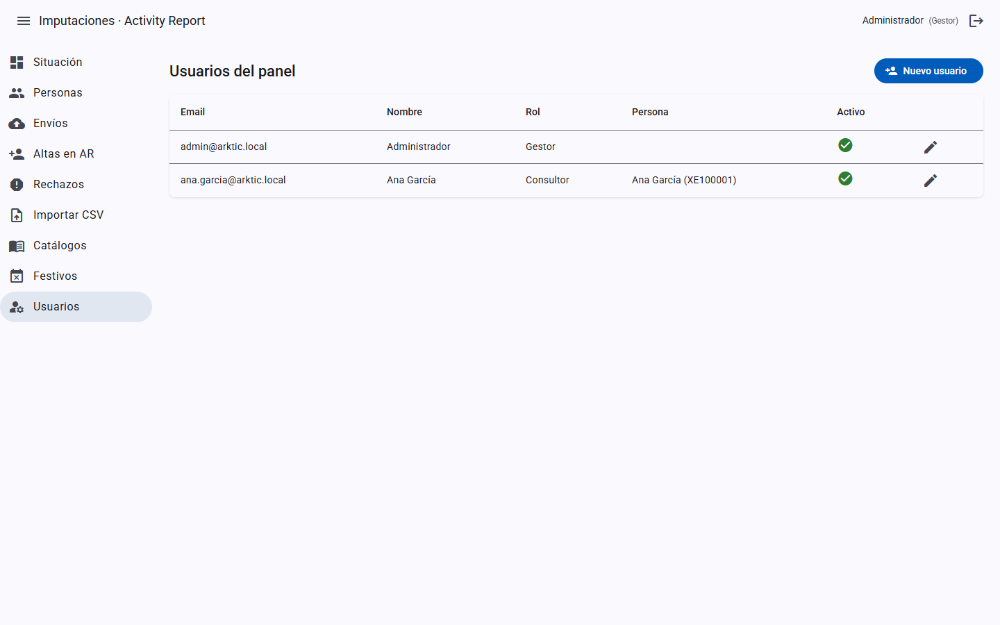

Quién puede entrar al panel. Un usuario **Consultor** tiene que tener una
**persona asociada**, que es la única que verá.

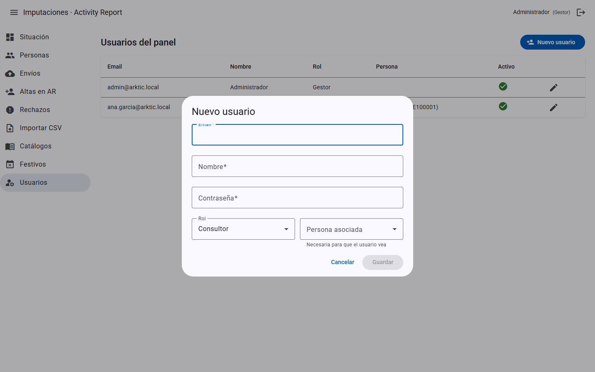

### Vista del consultor: Mi mes

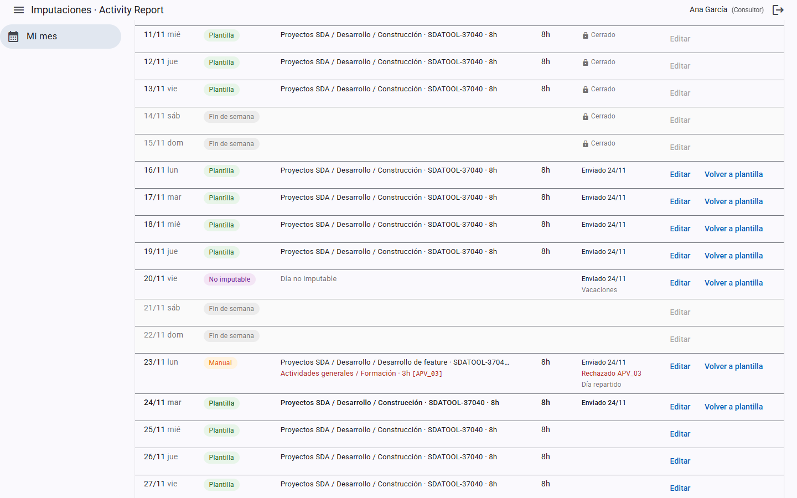

El consultor solo tiene "Mi mes": su calendario, con la misma tabla y las
mismas acciones que el gestor ve en el mes de una persona. En este ejemplo, el
23/11 tiene una línea rechazada por BBVA (`APV_03`).

## 5. Simular a BBVA: envíos, feedback y altas

En modo `filesystem` el conector usa la carpeta `samples/catalogues/` del
repositorio como si fuera BBVA:

| Qué | Dónde |
|---|---|
| Catálogos que "descarga" | `samples/catalogues/<catalogo>.csv` |
| Ficheros que "envía" | `samples/catalogues/outbox/<hora>_activities_<fecha>.csv` y `..._users_<fecha>.csv` |
| Feedback de imputaciones que "recibe" | `samples/catalogues/feedback/activities_<fecha de envío>_feedback.csv` |
| Feedback de altas que "recibe" | `samples/catalogues/feedback/users_<fecha de envío>_feedback.csv` |

Si el fichero de feedback no existe, el conector lo trata como "todavía no
disponible", igual que con BBVA.

**Simular el feedback de un envío de imputaciones:**

1. Haz un envío (Envíos → Enviar ahora) y busca el fichero en `outbox/`.
2. Cópialo a `samples/catalogues/feedback/activities_<fecha>_feedback.csv`,
   donde `<fecha>` es la fecha de envío (`AAAA-MM-DD`).
3. Añade al final de la cabecera la columna `;reason` y, al final de cada
   fila, `;` seguido del código de rechazo (`;APV_03`) o vacío (`;`) si se
   acepta. Las filas tienen que ser las mismas que las enviadas.
4. **Al día siguiente**, pulsa Rechazos → Sincronizar feedback. (El feedback
   de un envío de hoy no se busca hasta mañana, como pasa con BBVA.)

Códigos de rechazo de imputaciones más útiles para probar: `APV_01` fecha no
válida, `APV_03` actividad no válida, `APV_04` proyecto SDA no válido,
`APV_05` issue de Jira no válida, `APV_08` tiempo no válido. La lista completa
está en el documento de BBVA (`docs/activity-report-integracion-proveedores-v1.16.txt`).

**Simular el feedback de un envío de altas:**

1. Envía las altas pendientes (Altas en AR → Enviar altas pendientes).
2. Crea `samples/catalogues/feedback/users_<fecha>_feedback.csv` con este
   contenido, usando el **Person ID en mayúsculas** de cada persona (en su
   ficha):

   ```
   uid;reason
   <PERSON ID EN MAYÚSCULAS>;
   <PERSON ID DE OTRA PERSONA>;APV_UR_01
   ```

   Sin motivo = registrada; con motivo = rechazada.
3. Al día siguiente, pulsa Altas en AR → Sincronizar feedback.

## 6. Casos de prueba

Antes de empezar: entorno montado (punto 2), catálogos sincronizados y fechas
de un periodo abierto. "Hoy" es la fecha del equipo.

### 6.1 Acceso y permisos

| ID | Pasos | Resultado esperado |
|---|---|---|
| ACC-01 | Entrar con `admin@arktic.local` / `admin1234` | Entra en "Situación" con todo el menú |
| ACC-02 | Entrar con una contraseña incorrecta | Mensaje de error; no entra |
| ACC-03 | Crear un usuario Consultor asociado a una persona y entrar con él | Solo ve "Mi mes", con los días de su persona |
| ACC-04 | Como consultor, escribir en la barra de direcciones `http://localhost:4200/personas` | No accede a la pantalla de personas |
| ACC-05 | Desactivar ese usuario (Usuarios → editar → Activo) e intentar entrar con él | No puede entrar |

### 6.2 Personas y plantillas

| ID | Pasos | Resultado esperado |
|---|---|---|
| PER-01 | Nueva persona con todos los datos | Aparece en la lista; el GPS viene propuesto |
| PER-02 | Nueva persona con un UID que ya existe | Error; no se crea |
| PER-03 | Nueva persona sin email o sin nombre | El botón Guardar no se activa |
| PER-04 | Editar una persona y cambiar su email | El cambio se ve en la lista y en la ficha |
| PER-05 | Dar de baja una persona | Desaparece con "Solo activas"; aparece al quitar el filtro |
| PER-06 | Crear una persona sin plantilla con fecha de alta pasada | En Situación aparece con huecos y la columna Plantilla en rojo |
| PER-07 | Crearle una plantilla con `01.01.01` + `SDATOOL-37040` + 480 min | Sus huecos desaparecen; en su mes los días laborables pasan a "Plantilla" |
| PER-08 | Plantilla con `01.01.01` sin proyecto SDA | No se crea: "la actividad 01.01.01 exige proyecto SDA" |
| PER-09 | Plantilla con `03.02` (Reuniones) 600 min + `03.01` (Formación) 900 min | No se crea: "la suma del día es 1500 minutos, máximo 1440" |
| PER-10 | Crear una segunda plantilla desde una fecha posterior | La primera queda cerrada el día anterior; cada día usa la que le toca |
| PER-11 | Duplicar una plantilla y eliminar otra | Se duplica y se elimina; el mes se recalcula |

### 6.3 Mes e imputación manual

| ID | Pasos | Resultado esperado |
|---|---|---|
| MES-01 | Abrir el mes de una persona con plantilla | Laborables como "Plantilla", fines de semana y festivos marcados, días de quincenas cerradas con candado |
| MES-02 | Editar un día abierto → No imputable, nota "Vacaciones" | El día pasa a "No imputable" con la nota |
| MES-03 | Editar un día abierto con dos líneas: `01.01.02` + `SDATOOL-37040` + `ETR-01` 300 min y `03.01` 180 min | Se guarda como "Manual", total 8 h |
| MES-04 | En un día, elegir `01.01.02` y no poner issue de Jira | No deja guardar: la actividad exige issue |
| MES-05 | Elegir el proyecto `SDATOOL-37040` y buscar issues | Solo salen las de ese proyecto (`ETR-01`, `ETR-02`) |
| MES-06 | Imputar en `SDATOOL-40123` (dado de baja) o `03.03` (actividad antigua) | Error de validación; no se guarda |
| MES-07 | Línea de 0 minutos o de 1500 minutos | Error: los minutos van de 1 a 1440 |
| MES-08 | "Volver a plantilla" en un día manual | Vuelve a "Plantilla" |
| MES-09 | Intentar editar un día de una quincena cerrada | El botón Editar está desactivado (candado "Cerrado") |
| MES-10 | Editar un día futuro (de este periodo) | Se puede guardar; no se envía hasta que llegue el día |
| MES-11 | Navegar al mes anterior y al siguiente con las flechas; pulsar "Hoy" | Cambia de mes; "Hoy" vuelve al mes actual |
| MES-12 | Como consultor, editar un día propio | Se guarda igual que como gestor |

### 6.4 Festivos

| ID | Pasos | Resultado esperado |
|---|---|---|
| FES-01 | Crear un festivo **local** en un día laborable abierto para la geografía ES | En el mes de las personas de ES ese día sale "Festivo local" y se envía como no imputable |
| FES-02 | Crear un festivo **nacional** en un día laborable abierto | Ese día sale "Festivo nacional" y no aparece en el fichero de envío |
| FES-03 | Eliminar el festivo | El día vuelve a su plantilla |

### 6.5 Importación CSV

Usa los ficheros de [`docs/qa/ficheros/`](qa/ficheros/), cambiando las fechas
por días del periodo abierto.

| ID | Pasos | Resultado esperado |
|---|---|---|
| IMP-01 | Importar Días → `dias-ejemplo.csv` (fechas corregidas) | Mensaje con días creados/sustituidos; en los meses salen como "Importado" |
| IMP-02 | Importar Días → `dias-con-errores.csv` | "No se pudo importar. No se ha guardado nada" y la lista de errores con persona, día y motivo. Ningún día cambia, ni siquiera el de la primera fila, que es correcta |
| IMP-03 | Importar Días con un uid que no existe | Error "uid(s) desconocidos"; no se guarda nada |
| IMP-04 | Importar un CSV guardado desde Excel (con tildes y fechas `dd/mm/aaaa`) | Se importa bien; las tildes se ven correctamente |
| IMP-05 | Importar Personas → `personas-ejemplo.csv` → Comprobar | Muestra 2 nuevas, 1 actualizada (fecha de baja de Bruno), y que se pedirá el alta de 1; no guarda nada |
| IMP-06 | Pulsar Importar tras comprobar | Se crean y actualizan; David queda con alta pendiente en "Altas en AR" |
| IMP-07 | Volver a importar el mismo fichero de personas | Todas "Sin cambios" |
| IMP-08 | Descargar plantilla en cada pestaña | Se descarga un CSV con la cabecera correcta |

### 6.6 Envíos

| ID | Pasos | Resultado esperado |
|---|---|---|
| ENV-01 | Envíos → Previsualizar | Días, filas, huecos y el CSV, sin gastar cuota |
| ENV-02 | Comprobar el CSV previsualizado | Cabecera `date;person_id;task_level_1_code;…;time`, separador `;`, una fila por línea, `person_id` en hash (nunca el `XE…`), fines de semana y festivos nacionales ausentes |
| ENV-03 | Enviar ahora | Estado enviado; nueva fila OK en el histórico; cuota 1/3; el fichero aparece en `samples/catalogues/outbox/` |
| ENV-04 | Enviar ahora otra vez sin cambiar nada | No se envía ("sin cambios"); la cuota no sube |
| ENV-05 | Cambiar un día y volver a enviar | Se envía; cuota 2/3 |
| ENV-06 | Agotar la cuota (3 envíos con cambios) e intentar un cuarto | No se envía por cuota |
| ENV-07 | En el mes de una persona, tras enviar | Los días enviados muestran "Enviado dd/mm" |
| ENV-08 | Descargar el fichero de una fila del histórico | Coincide con el de `outbox/` |
| ENV-09 | Poner `AR_UPLOADS_ENABLED=false` en `.env`, reiniciar (`docker compose up -d`) y pulsar Enviar ahora | No se envía: "Envíos desactivados por configuración". Volver a ponerlo a `true` |

### 6.7 Feedback y rechazos

| ID | Pasos | Resultado esperado |
|---|---|---|
| FB-01 | Tras un envío, sin crear fichero de feedback, al día siguiente pulsar Sincronizar feedback | "Todavía no disponible"; sigue pendiente |
| FB-02 | Crear el feedback con una línea rechazada (punto 5) y sincronizar al día siguiente | El fichero aparece en Rechazos con 1 rechazada |
| FB-03 | Ver el mes de esa persona | El día sale con la línea en rojo y "Rechazado APV_xx" |
| FB-04 | Situación | La persona aparece con su rechazo y el contador de rechazos sube |
| FB-05 | Corregir el día rechazado y volver a enviar | El día se envía de nuevo |

### 6.8 Altas en AR

| ID | Pasos | Resultado esperado |
|---|---|---|
| ALT-01 | Pedir alta de una persona (icono en Personas o casilla al crearla) | Aparece en "Altas en AR" como pendiente |
| ALT-02 | Enviar altas pendientes | Pasa a "Enviada"; aparece un `users_<fecha>.csv` en `outbox/` con la columna `uids` y los `XE…` |
| ALT-03 | Simular el feedback de altas (punto 5) y sincronizar al día siguiente | Las personas sin motivo quedan "Registrada" y su fecha de alta pasa al día siguiente del envío; las que tienen motivo, "Rechazada" con su código |
| ALT-04 | En Personas, icono "Cancelar alta" de una persona pendiente | Deja de estar pendiente y desaparece de "Altas en AR" |
| ALT-05 | Intentar cancelar el alta de una persona ya enviada | No se permite |

### 6.9 Catálogos

| ID | Pasos | Resultado esperado |
|---|---|---|
| CAT-01 | Sincronizar ahora | Los 8 con fecha de hoy y sus filas, sin error |
| CAT-02 | Renombrar temporalmente `samples/catalogues/countries.csv` y sincronizar | `countries` muestra el error y conserva sus filas anteriores; el resto se sincroniza bien. Devolver el nombre al acabar |
| CAT-03 | Al editar un día, revisar los selectores | Solo ofrecen actividades imputables y vigentes, y proyectos y issues del catálogo |

### 6.10 Situación, avisos y procesos

| ID | Pasos | Resultado esperado |
|---|---|---|
| SIT-01 | Revisar las tarjetas de Situación | La quincena abierta y su fecha límite cuadran con la tabla del punto 3 |
| SIT-02 | Pulsar en el nombre de una persona con huecos | Abre su mes, con los huecos en rojo |
| SIT-03 | Enviar avisos ahora | Mensaje con el número de avisos; aparecen en "Avisos enviados" con canal LOG |
| SIT-04 | Volver a pulsar Enviar avisos ahora | No duplica los avisos de hoy |
| SIT-05 | Parar la aplicación (`docker compose stop`), esperar a que pase la hora de un proceso, arrancarla (`docker compose start`) y esperar unos minutos | El proceso se ejecuta al arrancar y aparece como "recuperada" |

### 6.11 Generales

| ID | Pasos | Resultado esperado |
|---|---|---|
| GEN-01 | Recargar el navegador (F5) en cualquier pantalla | Sigue en la misma pantalla con la sesión abierta |
| GEN-02 | Reiniciar el equipo con Docker Desktop configurado para arrancar solo | La aplicación vuelve a estar disponible sin hacer nada |
| GEN-03 | Probar con la ventana estrecha (portátil pequeño) | Las tablas se pueden leer y los diálogos caben |

## 7. Cómo informar de un fallo

Para cada fallo, indica:

- El **ID del caso** (por ejemplo, `MES-04`) o, si no es de la lista, la
  pantalla.
- **Pasos exactos** y los datos usados (persona, día, códigos).
- **Qué esperabas** y **qué ha pasado**, con una captura.
- Si hay un error del servidor, el log del backend:

  ```powershell
  docker compose logs backend --tail 100
  ```

- Si afecta a un envío, el fichero de `outbox/` o el de la fila del histórico.

## 8. Reiniciar el entorno

Para empezar de cero, con la base de datos vacía:

```powershell
docker compose down -v
```

```powershell
docker compose up --build -d
```

`down -v` **borra la base de datos** del entorno de pruebas. Después hay que
volver a sincronizar los catálogos. Los ficheros de `samples/catalogues/outbox/`
y `feedback/` no se borran solos: se pueden eliminar a mano.
